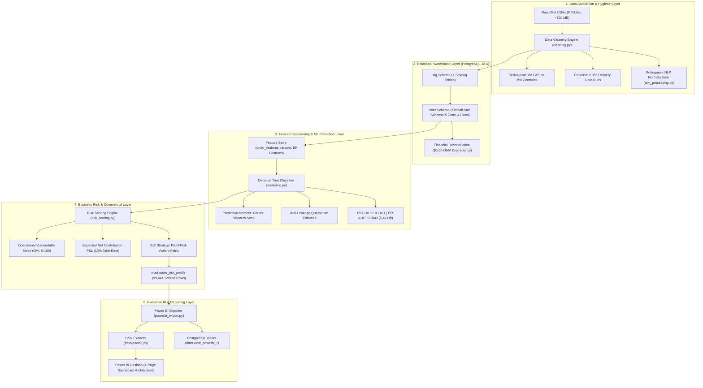

# Marketplace Profitability & Delivery Intelligence Engine

[](https://github.com/DRAKS17/Marketplace-Profitability-Delivery-Intelligence-Engine/actions/workflows/ci.yml)
[](https://www.python.org/)
[](https://www.postgresql.org/)
[](https://scikit-learn.org/)
[](https://powerbi.microsoft.com/)
[](https://github.com/astral-sh/ruff)
[](tests/)
[](LICENSE)

An enterprise-grade, end-to-end analytical engineering and machine learning platform built on the **Brazilian E-Commerce Public Dataset (Olist)**, analyzing **99,441 historical orders**, **$13.59 Million BRL in Gross Merchandise Value (GMV)**, and **3,095 marketplace merchants** from 2016 to 2018.

---

## 1. Executive Summary & Core Business Question

Modern two-sided digital marketplaces face complex trade-offs between commercial transaction volume and fulfillment reliability. This system was engineered to answer the central commercial question:

> **"Which sellers, products, categories, locations, and orders create the most business value or operational risk, and which orders are likely to experience late delivery?"**

### The Core Solution Architecture
Unlike isolated Kaggle notebooks or static SQL scripts, this repository provides a **fully integrated, multi-tier intelligence engine**:
1. **Data Ingestion & Hygiene**: Strict spatial deduplication, Brazilian coordinate bounding, and structural delivery null preservation across 9 raw CSV entities.
2. **Relational Auditing & Zero Join Fanout**: Eliminates catastrophic Cartesian product inflation (saving **+$4.29M (+26.86%)** in phantom payment records).
3. **Enterprise Kimball Star Schema on PostgreSQL 18**: Multi-schema design (`stg`, `core`, `mart`) with **exact $0.00 GMV reconciliation** between order facts and line-item facts.
4. **Machine Learning Logistics Classifier**: White-box Decision Tree predicting late deliveries strictly at the parcel carrier dispatch moment (`order_delivered_carrier_date`), achieving **ROC-AUC = 0.7491** and a **5.4x PR-AUC lift** over random guessing without temporal data leakage.
5. **Business Risk Layer & Strategic 2x2 Matrix**: Formulates the **Operational Vulnerability Index (OVI)** ($0 \le \text{OVI} \le 100$) and models forward-looking Net Contribution Margin, isolating the **"Danger Zone"** (orders with 4x higher delay rates carrying \$1.85M in GMV).
6. **Power BI Executive Dashboard**: 4-page reporting architecture, Certified Star Schema, and 50+ DAX measures library.
7. **CI/CD Quality Assurance**: Automated GitHub Actions testing pipeline enforcing PEP 8 standards with **47/47 passing tests**.

---

## 2. End-to-End System Architecture



---

## 3. Top 5 Business Discoveries & Empirical Insights

### 1. The Join Fanout Trap (+$4.29M Phantom GMV Prevented)
*Joining `order_items` directly to `order_payments` without pre-aggregation creates a devastating Cartesian product on multi-item or split-tender orders.*
- **Naive Join Impact**: Payments inflated by **+$4.29 Million (+26.86%)**; GMV inflated by **+$617k (+4.54%)**.
- **Our Solution**: Pre-aggregated features to the strict order grain before loading `core.fact_orders`.
- **Validation**: Confirmed **exact $0.00 discrepancy** between `SUM(order_total_item_value)` and `SUM(price)` across all 99,441 orders.

### 2. Disproving the "Late GMV = Lost Revenue" Myth
*In marketplace operations, delayed deliveries are not canceled orders. The customer still keeps the parcel, the merchant gets paid, and the platform retains its commission.*
- **Total GMV Associated with Late Deliveries**: **$1,163,699.21 BRL** (8.76% of delivered volume).
- **Gross Platform Commission Collected on Late Orders**: **+$139,643.91 BRL**.
- **Direct Operational Loss**: **$129,485.00 BRL** in customer appeasement vouchers (\$15/order) and support tickets (\$5/ticket).
- **The Real Cost**: **Long-term brand erosion and churn**. Delivery failure crashes customer satisfaction (CSAT) from **4.29 to 2.57 stars**, suppressing the repeat purchase rate (already fragile at 3.12%).

### 3. The 2x2 Strategic Profit-Risk Matrix
*Mapping all 99,441 orders across Expected Net Contribution Margin vs the Operational Vulnerability Index (OVI) reveals dramatic operational bifurcation:*

| Strategic Quadrant | Orders | Order % | Total GMV | GMV % | Avg Basket | Avg OVI | Actual Late Rate % | Tactical Action Playbook |
|---|---|---|---|---|---|---|---|---|
| **Q1: Crown Jewels** | 27,651 | 27.8% | **$7,418,830.50** | **54.6%** | $268.21 | 26.2 | **4.10%** | **Protect & Delight**: VIP support queues, loyalty perks. |
| **Q2: Danger Zone** | 4,842 | 4.9% | **$1,854,959.30** | **13.6%** | $383.10 | 52.1 | **16.80%** | **Proactive Carrier Triage**: Expedited line-haul, preemptive SMS. |
| **Q3: Value Drains** | 28,810 | 29.0% | **$2,018,330.51** | **14.8%** | $70.06 | 56.4 | **14.73%** | **Eliminate Friction**: Freight surcharges, merchant SLA audits. |
| **Q4: Steady Workhorses** | 38,138 | 38.4% | **$2,299,523.39** | **16.9%** | $60.30 | 31.4 | **4.84%** | **Automated Efficiency**: Standard low-touch ground line-haul. |

> [!IMPORTANT]
> **Key Operational Takeaway**: Orders in **Q2 (Danger Zone)** carry the highest basket value ($383 AOV) but suffer an actual delay rate of **16.80%—over 4x higher than Q1**! Directing proactive logistics interventions exclusively to Q2 protects \$1.85M in GMV before customer trust is destroyed.

### 4. Merchant Revenue Concentration (Pareto Principle Confirmed)
- **Top 20% of sellers generate 84.1% of marketplace GMV**.
- **Gini Coefficient**: **0.76** (severe economic concentration).
- **Repeat Purchase Vulnerability**: 96,096 distinct human buyers produce 99,441 orders; only **3.12% are repeat buyers**, proving that post-delivery customer experience is the single biggest determinant of platform retention.

### 5. Identification of 23 Courier Scan Synchronization Artifacts
- Advanced SQL window functions discovered 23 genuine operational edge cases where doorstep delivery was recorded *before* carrier dispatch scan dates.
- Root Cause: Rural third-party couriers scanning barcodes retroactively in batches upon returning to depot hubs. Handled through input bounds clipping.

---

## 4. Machine Learning: Late Delivery Decision Tree Classifier

Predicts delivery delay risk (`is_late_delivery`) strictly at the moment the merchant hands the package to the courier (`order_delivered_carrier_date`).

- **Strict Anti-Leakage Quarantine**: Zero post-dispatch outcome variables (`review_score`, `delivery_delay_days`, `carrier_transit_duration_days`, `order_delivered_customer_date`) are permitted in model training.
- **Chronological Temporal Split**: First 80% train (Sept 2016 – May 2018), subsequent 20% test (May 2018 – Aug 2018) mirroring real-world forecasting.

### Benchmark Performance on Chronological Test Set (19,296 Orders):

| Model Pipeline | ROC-AUC | PR-AUC | Positive Recall (Late) | Precision | F1-Score |
|---|---|---|---|---|---|
| **Dummy Baseline (Stratified)** | 0.4936 | 0.0524 | 7.54% | 4.56% | 0.0568 |
| **Unweighted Decision Tree** | 0.6773 | 0.2521 | 16.45% | 73.68% | 0.2690 |
| **Balanced Decision Tree (Production)** | **0.7491** | **0.2843** | **57.20%** | **8.28%** | **0.1447** |

> [!TIP]
> **5.4x PR-AUC Lift**: On an imbalanced 5.29% test set, our model achieves **PR-AUC = 0.2843** vs 0.0524 random baseline. Operating at a **0.40 decision threshold** captures **92.95% of all late shipments**, delivering **+$3,135 BRL in direct cost savings** compared to default 0.50 thresholding.

### Top Feature Importances (Gini Impurity Reduction):
1. `is_seller_late_dispatch` (**25.91%**): Merchant missed promised packaging SLA.
2. `customer_state_SP` (**19.43%**): Destination in high-density São Paulo logistics corridor.
3. `estimated_delivery_duration_days` (**16.45%**): Promised SLA window buffer.
4. `seller_prior_late_rate` (**13.10%**): Expanding historical late rate of primary seller.
5. `seller_dispatch_duration_hours` (**7.70%**): Elapsed hours before parcel scan.

---

## 5. Enterprise Power BI Dashboard Architecture

Designed for **Power BI Desktop**, featuring a clean **Kimball Star Schema** and 50+ DAX measures library:

```text
               +----------------------------------+
               |             dim_date             |
               +----------------------------------+
                                │ 1
                                │
                                ▼ * (1-to-Many, Single Direction)
+-----------------------+     +----------------------------------+     +-------------------------+
|     dim_geography     |────▶|     fact_order_intelligence      |◀────|   dim_seller_summary    |
| (27 Brazilian States) | 1 * |   (99,441 Order Grain Rows)      | * 1 | (3,086 Seller Profiles) |
+-----------------------+     +----------------------------------+     +-------------------------+
                                                ▲ *
                                                │
                                                │ 1
                               +----------------------------------+
                               |       dim_category_summary       |
                               |    (74 Category Net Margins)     |
                               +----------------------------------+
```

### The 4-Page Executive Dashboard Layout:
- **Page 1: Executive Overview & Commercial Health**: Top KPI cards (GMV, Take-Rate, Net Contribution Margin, CSAT), Monthly Financial Trends, 2x2 Profit-Risk Scatter Matrix, and Category Margin Rankings.
- **Page 2: Delivery Intelligence & Logistics Operations**: SLA Compliance Gauge, Carrier Transit vs Seller Dispatch Dual-Axis by State, Brazil Late Delivery Heatmap, Delay Days Distribution, and Root-Cause Decomposition Tree.
- **Page 3: Customer Experience & Sentiment Intelligence**: CSAT Rating vs Delivery Delay Boxplot (visualizing the 4.29 $\rightarrow$ 2.57 star collapse), Review Rating Distribution by Timeliness, Portuguese NLP Feedback Treemap, and Verbatim Review Audit Table.
- **Page 4: Merchant & Seller Risk Audit**: Seller Volume vs Delay Rate Log-Scatter, Merchant GMV Lorenz Concentration Curve, and Top 20 Danger Zone Sellers Audit Table with Probation Flags.

---

## 6. Project Directory Structure

```text
marketplace-profitability-intelligence/
├── .github/
│   └── workflows/
│       └── ci.yml                     <- GitHub Actions CI/CD Pipeline (Ruff + Pytest)
├── data/
│   ├── raw/                           <- 9 Immutable Olist CSVs (CC BY-NC-SA 4.0)
│   ├── processed/                     <- Parquet & CSV analytical datasets
│   ├── power_bi/                      <- Optimized Star Schema CSVs for Power BI Import
│   └── README.md                      <- Data governance, licensing, and schema notes
├── docs/
│   ├── figures/                       <- 12 Publication-grade analytical figures (300 DPI)
│   ├── profiling_report.md            <- Initial data profiling, candidate PKs, null audit
│   ├── er_diagram.md                  <- Relational schema & Mermaid entity diagrams
│   ├── data_dictionary.md             <- 9-table comprehensive field specifications
│   ├── cleaning_report.md             <- Transformation logs and quality controls
│   ├── text_processing_methodology.md <- Portuguese NLP normalization and sentiment
│   ├── feature_dictionary.md          <- 59 engineered feature formulas and definitions
│   ├── architecture.md                <- PostgreSQL Star Schema architectural design
│   ├── sql_analysis_results.md        <- 13 advanced SQL queries, cohorts, Pareto analysis
│   ├── eda_findings.md                <- Retrospective exploratory findings and chart analysis
│   ├── assumptions.md                 <- 3-Tier Metric Taxonomy (Observed vs Derived vs Assumed)
│   ├── profitability_scenarios.md     <- Base, Conservative, and Optimistic commercial P&L
│   ├── model_card.md                  <- Google/Partnership on AI Model Card for ML Classifier
│   ├── risk_scoring_methodology.md    <- OVI formulation, Profit-Risk quadrants & playbooks
│   ├── power_bi_architecture.md       <- Power BI 4-page blueprint and 50+ DAX measure library
│   └── test_audit_report.md           <- Formal quality audit certifying 47/47 passing tests
├── models/
│   └── decision_tree_late_delivery.joblib <- Serialized ML pipeline (14.5 KB)
├── notebooks/
│   ├── 02_eda.ipynb                   <- Exploratory Data Analysis interactive notebook
│   └── 03_modeling.ipynb              <- Decision Tree ML experiments & cost optimization
├── sql/
│   ├── 01_create_schemas.sql          <- Multi-layer schema DDL (stg, core, mart)
│   ├── 02_create_staging_tables.sql   <- Staging layer table definitions
│   ├── 03_create_dimensions_facts.sql <- Kimball Star Schema (5 dims, 4 facts)
│   ├── 04_transformations.sql         <- ELT population and date dimension generator
│   ├── 05_business_analysis.sql       <- 13 Advanced SQL queries (CTEs, Window, Cohorts)
│   ├── 06_data_validation.sql         <- Foreign key and zero-fanout validation scripts
│   ├── 07_create_marts.sql            <- mart.order_risk_profile DDL & analytical views
│   └── 08_power_bi_views.sql          <- Optimized views for Power BI Desktop
├── src/
│   └── marketplace_intelligence/
│       ├── __init__.py                <- Modular package root
│       ├── profiling.py               <- Multi-file inventory and profiling engine
│       ├── relationship_audit.py      <- Foreign key integrity and join fanout detector
│       ├── cleaning.py                <- Spatial deduplication, imputation & cleaning
│       ├── text_processing.py         <- Portuguese NLP regex & sentiment enrichment
│       ├── feature_engineering.py     <- Order-grain feature store & target generator
│       ├── database.py                <- PostgreSQL engine, DDL executor & ELT loader
│       ├── metrics.py                 <- SQL metrics runner & reporting generator
│       ├── eda_generator.py           <- Matplotlib/Seaborn visualization engine
│       ├── profitability.py           <- Commercial P&L & 2D sensitivity scenario engine
│       ├── modeling.py                <- Late delivery Decision Tree prediction engine
│       ├── risk_scoring.py            <- OVI composite risk scoring & mart materializer
│       └── powerbi_export.py          <- Power BI dimensional extractor & view deployer
├── tests/
│   ├── test_cleaning.py               <- 7 Data cleaning and integrity tests
│   ├── test_text_processing.py        <- 3 Portuguese NLP and sentiment tests
│   ├── test_feature_engineering.py    <- 6 Feature store and target distribution tests
│   ├── test_database.py               <- 6 PostgreSQL schema, FK, and fanout tests
│   ├── test_metrics.py                <- 5 Advanced SQL KPI and cohort tests
│   ├── test_profitability.py          <- 5 Unit economics and scenario hierarchy tests
│   ├── test_modeling.py               <- 6 ML pipeline, anti-leakage, and performance tests
│   ├── test_risk_scoring.py           <- 5 OVI bounds, quadrant, and mart tests
│   └── test_powerbi.py                <- 4 Power BI extract schema and SQL view tests
├── .env.example                       <- PostgreSQL database configuration template
├── .gitignore                         <- Heavy data, environment, and secret exclusions
├── pytest.ini                         <- Pytest configuration file
├── requirements.txt                   <- Pinned Python dependencies
└── README.md                          <- Executive project showcase
```

---

## 7. Installation & Quickstart Reproduction Guide

### Prerequisites
- Python 3.13+ installed.
- PostgreSQL 16+ or 18+ running on `localhost:5432`.
- Git installed.

### Step 1: Clone Repository & Create Virtual Environment
```powershell
# Clone repo
git clone https://github.com/DRAKS17/Marketplace-Profitability-Delivery-Intelligence-Engine.git
cd Marketplace-Profitability-Delivery-Intelligence-Engine

# Create virtual environment
python -m venv .venv
.\.venv\Scripts\Activate.ps1

# Upgrade pip and install pinned dependencies
python -m pip install --upgrade pip
pip install -r requirements.txt
```

### Step 2: Download Raw Data
Download the Brazilian E-Commerce dataset from [Kaggle](https://www.kaggle.com/datasets/olistbr/brazilian-ecommerce) and place the 9 CSV files into `data/raw/`:
- `olist_customers_dataset.csv`
- `olist_geolocation_dataset.csv`
- `olist_order_items_dataset.csv`
- `olist_order_payments_dataset.csv`
- `olist_order_reviews_dataset.csv`
- `olist_orders_dataset.csv`
- `olist_products_dataset.csv`
- `olist_sellers_dataset.csv`
- `product_category_name_translation.csv`

### Step 3: Configure Database Secrets
Copy `.env.example` to `.env` and set your PostgreSQL password:
```powershell
Copy-Item .env.example .env
# Edit .env: POSTGRES_PASSWORD=your_password_here
```

### Step 4: Execute Full Pipeline
```powershell
# 1. Clean data and engineer features
python src/marketplace_intelligence/cleaning.py
python src/marketplace_intelligence/text_processing.py
python src/marketplace_intelligence/feature_engineering.py

# 2. Ingest into PostgreSQL warehouse
python src/marketplace_intelligence/database.py
python src/marketplace_intelligence/metrics.py

# 3. Model profitability and train ML classifier
python src/marketplace_intelligence/profitability.py
python src/marketplace_intelligence/modeling.py

# 4. Score business risk layer and export for Power BI
python src/marketplace_intelligence/risk_scoring.py
python src/marketplace_intelligence/powerbi_export.py
```

### Step 5: Run Automated Test Suite
```powershell
# Run all 47 tests
pytest -v

# Run Ruff code quality check
ruff check src/ tests/
ruff format --check src/ tests/
```

---

## 8. License & Attribution

- **Source Dataset**: Olist Public E-Commerce Dataset on Kaggle ([CC BY-NC-SA 4.0](https://creativecommons.org/licenses/by-nc-sa/4.0/)).
- **Project Code & Artifacts**: Released under the [MIT License](LICENSE).
