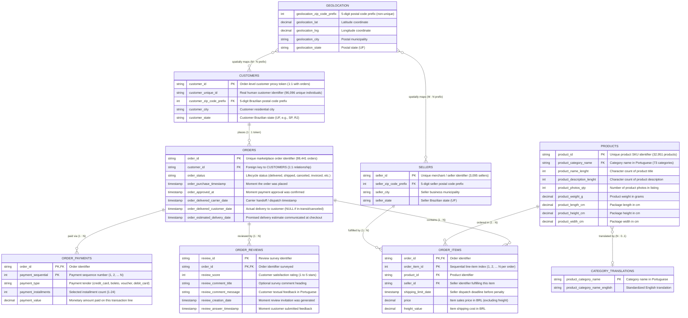

# Entity-Relationship (ER) Architecture Diagram

This diagram documents the relational architecture, cardinalities, primary keys, and foreign keys of the 9 Olist source entities, verified via empirical data testing.

---

## 1. Relational ER Diagram (Mermaid)

---

## 2. Cardinality Summary Table

| Relationship | Cardinality | Key / Join Condition | Enforced In Integrity Audit |
|---|---|---|---|
| `CUSTOMERS` ➔ `ORDERS` | **1 : 1** | `customer_id` | ✅ 0 orphans; exactly 1 order per `customer_id`. |
| `UNIQUE_PERSON` ➔ `CUSTOMERS` | **1 : N** | `customer_unique_id` | ✅ 96,096 individuals generate 99,441 customer order tokens. |
| `ORDERS` ➔ `ORDER_ITEMS` | **1 : N** | `order_id` | ✅ 0 orphans; max 21 items in a single order; 775 canceled orders have 0 items. |
| `PRODUCTS` ➔ `ORDER_ITEMS` | **1 : N** | `product_id` | ✅ 0 orphans; all 32,951 ordered products exist in catalog. |
| `SELLERS` ➔ `ORDER_ITEMS` | **1 : N** | `seller_id` | ✅ 0 orphans; all 3,095 sellers exist in merchant registry. |
| `ORDERS` ➔ `ORDER_PAYMENTS` | **1 : N** | `order_id` | ✅ 0 orphans; max 29 payment splits in a single order; 1 order has 0 payments. |
| `ORDERS` ➔ `ORDER_REVIEWS` | **1 : N (Composite PK)** | `order_id` | ✅ 0 orphans; 98,410 unique review IDs; 814 shared across multi-order surveys. |
| `PRODUCTS` ➔ `CATEGORY_TRANSLATIONS`| **N : 0..1** | `product_category_name` | ⚠️ 71 categories mapped; 2 categories (`portateis_cozinha_e_preparadores_de_alimentos`, `pc_gamer`) missing translation. |
| `CUSTOMERS / SELLERS` ➔ `GEOLOCATION` | **N : M** | `zip_code_prefix` | ⚠️ Geolocation contains multiple coordinates per prefix; 157 customer zip prefixes missing in geo table. |
